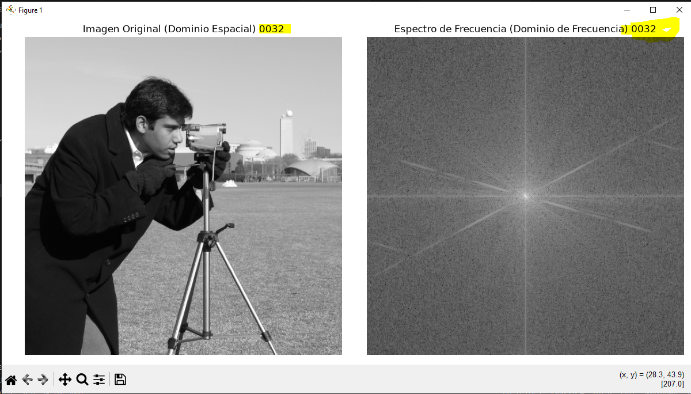
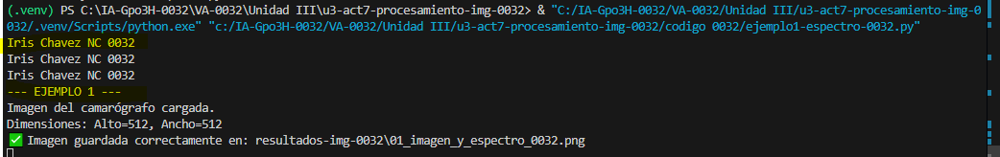
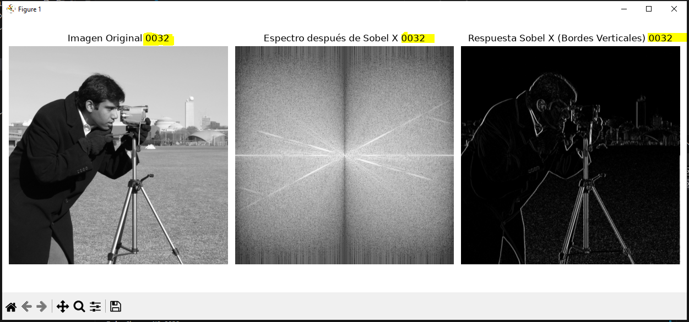
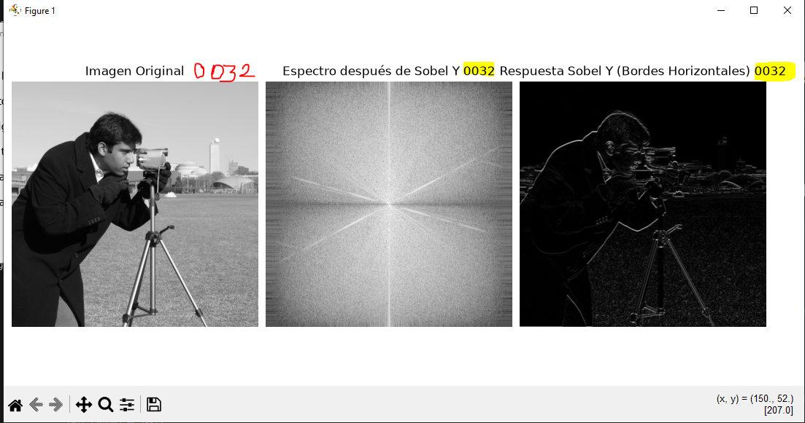
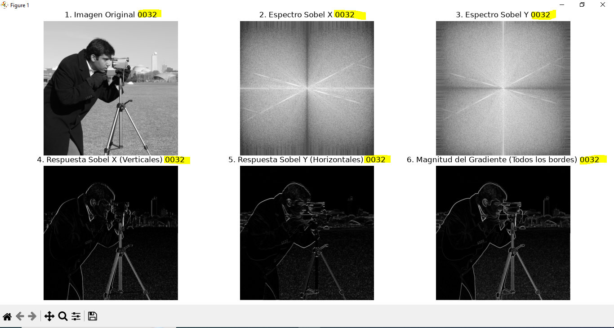

## 🎯 Propósito de la actividad
Conocer y utilizar 60 imágenes diferentes para realizar prácticas de procesamiento digital de imágenes mediante Python.

Las imágenes permitirán experimentar con operaciones como:

🔍 Detección de bordes y contornos.
🎨 Análisis de colores y canales RGB.
🌫️ Aplicación de filtros y reducción de ruido.
📊 Análisis de histogramas y contraste.
🔄 Rotación, recorte y redimensionamiento.
🧩 Segmentación y reconocimiento de regiones.
📐 Detección de características y patrones.
Importante: Scikit-image incluye fotografías, imágenes científicas, texturas y patrones sintéticos. Por eso, no todos los ejemplos corresponden a fotografías reales.

## Ejemplo 1

## En terminal 

## Ejemplo 2

## Ejemplo 3

## Ejemplo 4
